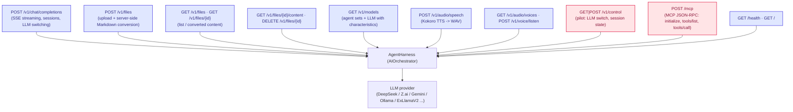

# AgentBridge and its clients

AgentBridge is a .NET 10 application (ASP.NET Minimal Host) that **hosts** the `AIOrchestrator`
library (which is not directly executable on its own) and exposes its chat pipeline through
**OpenAI-compatible** REST endpoints, plus a small set of documented proprietary extensions
(TTS, LLM switching, platform status). Any OpenAI SDK, script or standalone client can drive
the agents without modification.

```mermaid
flowchart LR
  subgraph host["Application host — AgentBridge (single process, ASP.NET Minimal Host)"]
    program["Program.cs<br/>startup + wiring"]
    httpapi["/v1/* OpenAI-compatible API<br/>chat, files, models,<br/>audio/speech, voice/listen,<br/>control, mcp, health"]
    sessions[("SessionStore<br/>session = AgentHarness + history")]
  end

  subgraph clients["Clients (who reaches AgentBridge)"]
    tui["Terminal GUI client<br/>(Tui.cs)<br/>local HTTP"]
    giraffe{{"Giraffe AI<br/>web client<br/>external repo Graphene-Lab/GiraffeAI"}}
    office["OfficeManager web app<br/>[OfficeManager/index.html]"]
    sdk["OpenAI SDK / curl / script<br/>external"]
    freecad{{"FreeCAD workbench<br/>reads AGENTBRIDGE_URL"}}
  end

  subgraph channels["Channel bridges (in-process, no HTTP endpoint)"]
    tg["Telegram bridge<br/>[TelegramBridge.cs]<br/>WTelegramClient userbot"]
    sip["SIP bridge<br/>[SipBridge.cs]<br/>SIPSorcery user agent"]
  end

  program -->|"binds"| httpapi
  httpapi -->|"owns chats (by id)|" sessions

  tui -->|"local HTTP /v1/chat/completions"| httpapi
  tui -->|"opens browser"| office
  giraffe -->|"HTTP /v1/chat/completions"| httpapi
  sdk -->|"HTTP /v1/chat/completions, /v1/files, ..."| httpapi
  freecad -->|"env AGENTBRIDGE_URL -> /v1/chat/completions"| httpapi
  office -->|"duplex WebSocket /ws/office"| httpapi

  tg -->|"per-user sessions (no HTTP, WTelegramClient)"| sessions
  sip -->|"per-call conversations (VoiceConversation)"| sessions

  classDef hostC fill:#dbeafe,stroke:#2563eb,stroke-width:1.5px,color:#172554
  classDef cliC fill:#fef3c7,stroke:#d97706,stroke-width:1.5px,color:#78350f
  classDef chanC fill:#dcfce7,stroke:#16a34a,stroke-width:1.5px,color:#14532d
  class program,httpapi,sessions hostC
  class tui,giraffe,office,sdk,freecad cliC
  class tg,sip chanC
```

## The clients, one by one

| Client | How it connects | What it uses |
|---|---|---|
| **TUI** (`Tui.cs`) | Local HTTP on `Urls` (e.g. `http://localhost:5290`), starts with `agent` / `dotnet run` | `/v1/chat/completions` (streaming), `/v1/models`, `/v1/voice/listen`, the `/telegram` and `/sip` commands that call the bridges in-process |
| **Giraffe AI** (web client) | External repo, installed at runtime in the server folder; the server tells it this instance's endpoint | `/v1/chat/completions`, `/v1/audio/speech` |
| **OfficeManager** (`OfficeManager/index.html`) | Served by the same host on `/OfficeManager`; duplex hub on `/ws/office` | WebSocket `/ws/office` for chat + agent lifecycle tracking |
| **OpenAI SDK / curl / scripts** | Call the standard endpoints | `/v1/chat/completions`, `/v1/files`, `/v1/models`, `/v1/audio/speech` — no modifications |
| **FreeCAD workbench** | Reads the `AGENTBRIDGE_URL` environment variable (set in DEBUG by `Program.cs`) | `/v1/chat/completions` for the in-CAD chat |

## Endpoints



> The **proprietary** endpoints (`/v1/control`, `/v1/voice/listen`, `/v1/audio/voices`, `/mcp`)
> are documented and additive: a strict OpenAI client ignores them. Platform-dependent features
> return **501 (unavailable)** when their assets are missing, and `/v1/control` /
> `/v1/audio/voices` always report what is really available.
