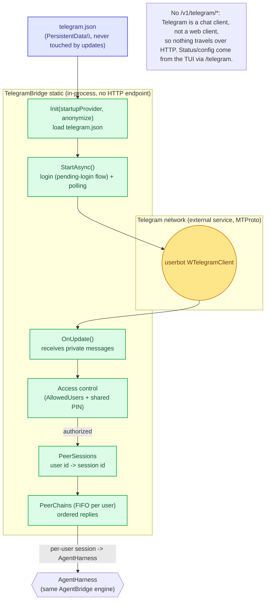
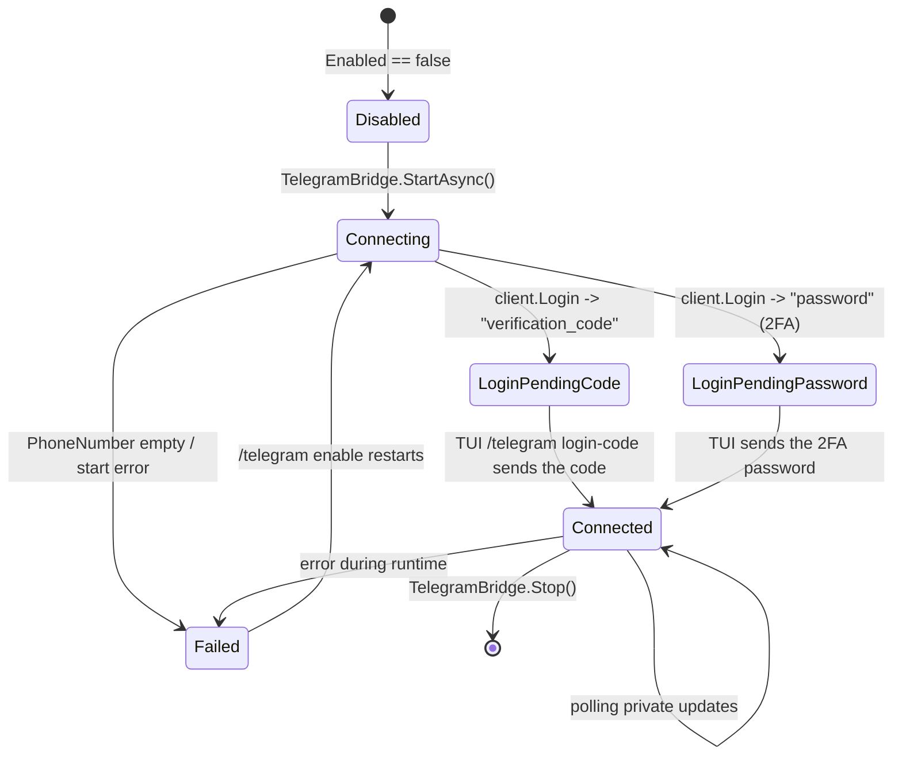

# The Telegram bridge implementation

Telegram is treated as a **text-chat medium** — like the TUI or the web client, **not** a SIP-style
voice medium (SIP is a phone call / RTP). A private message (text and/or file attachments) is
handed to the agent through a **per-user session** and the reply (text + attachments) goes back to
the same chat. **There is no audio**: Telegram's client API has no support for voice calls, so
Telegram adds **no** `IAudioMedia` and **no** `VoiceConversation` — the media list stays
**SIP (phone calls)** and **Voice (desktop microphone)**.

The transport is the [WTelegramClient](https://github.com/wiz0u/WTelegramClient) **4.4.8**
library (userbot, MTProto).



## Lifecycle



The phases (`TelegramPhase`: `Disabled`, `Connecting`, `LoginPendingCode`, `LoginPendingPassword`,
`Connected`, `Failed`) are surfaced to the TUI (`GET /v1/telegram/status` does not exist — Telegram
has no HTTP endpoints; status is seen from the TUI `/telegram`). The **first login** is guided by
the TUI: the verification code (and 2FA password if enabled) comes through the `pending-login`
flow (`/telegram login-code`), and the session persists in a `.session` file under
`PersistentData\` (no code is asked again after the first login).

## Internal structure

| Element | Purpose |
|---|---|
| `TelegramConfig` | Mirror of `telegram.json`: `Enabled`, `ApiId`/`ApiHash` (built-in default, override only for a custom install app), `PhoneNumber`, `SessionPath` (`telegram.session`), `AllowedUsers`, `Agent` |
| `PeerSessions` (`ConcurrentDictionary<long,string>`) | user id -> session id (the agent harness identified per chat) |
| `PeerLocks` (`ConcurrentDictionary<long,object>`) | per-user lock to avoid duplicate session creation |
| `PeerChains` (`ConcurrentDictionary<long,Task>`) | **FIFO per user**: the same chat's replies stay ordered, no interleave |
| `_client` / `_manager` | `WTelegram.Client` + `UpdateManager` (created under the lock to avoid double-create) |
| `_pendingLogin` | `TaskCompletionSource<string>` to wait for the login code from the TUI |

`Init` loads `telegram.json` and remembers the provider/anonymize used for the sessions.
`StartAsync` runs the login loop to completion (when a code is pending it does not block the one
that must wait); callers that must not block (boot, `/telegram enable`) wrap it in `Task.Run`.

## Access control (closed by default)

Only users listed in `AllowedUsers` (numeric Telegram ids and/or `@usernames`) may talk. An
**unlisted** user who sends the **shared external-client access PIN** — the same `Sip:Pin` used
for phone calls (changed from the TUI with `/sip config set Pin`) — is added to the allow-list on
the spot and greeted with the same "How can I help you?" used after a SIP login. Wrong/locked PIN
attempts share the SIP gate budget (machine-wide lockout, persisted in `sipstate.json`): guessing
is rate-limited across every medium.

```mermaid
flowchart LR
  msg["Private message<br/>(text + attachments)"] --> chk{"Is the user in<br/>AllowedUsers?"}
  chk --| "yes" |sess["Agent session -><br/>AgentHarness -> reply"]
  chk --| "no" |pin["Asks for the shared<br/>external PIN (Sip:Pin)"]
  pin --> chk2{"Correct PIN<br/>(one attempt / budget<br/>shared with SIP?)"}
  chk2 --| "yes" |enroll["Enroll in allow-list +<br/>greet 'How can I help you?'"]
  chk2 --| "no" |lock["Discard / lock<br/>(persisted in sipstate.json)"]
  enroll --> sess

  classDef okC fill:#dcfce7,stroke:#16a34a,stroke-width:1.5px,color:#14532d
  classDef warnC fill:#fef3c7,stroke:#d97706,stroke-width:1.5px,color:#78350f
  class sess,enroll okC
  class chk,pin,chk2,lock warnC
```

> The configuration is editable from the TUI (`/telegram`) **or by hand** in `telegram.json`; it is
> never overwritten by updates (single-directory rule: `PersistentData\`). The deployment only has
> to set the `PhoneNumber` — the app credentials (`api_id`/`api_hash`) are built-in (AgentBridge's
> own app identity).
