# Software parts and their interactions

The ecosystem is split into **layers** with precise, real dependency/usage relationships (the
arrows are actual reference/usage links, not conceptual ones). The key rule: the **`AIOrchestrator`**
library is **not directly executable on its own** — it is hosted by a host (`AIOffice` as an
in-process Blazor app, `AgentBridge` as an HTTP server). The **plugin tools** are not compile-time
references of the host: they are assemblies **loaded dynamically** from the `Tools/` folder at
runtime.

```mermaid
flowchart TD
  subgraph host["Hosts (executables)"]
    aioffice["AIOffice<br/>Blazor Server app + Voice panel<br/>[Program.cs, Panels/*]"]
    agentbridge["AgentBridge<br/>OpenAI-compatible HTTP server<br/>[Program.cs, Tui.cs, */Bridge.cs]"]
  end

  subgraph lib["AIOrchestrator library (not directly executable)"]
    harness{{"AgentHarness<br/>(agent loop, attachments, streaming)"}}
    core["Native system tools<br/>FileTool, GitTool, TaskSchedulerTool,<br/>WebTool, EMailTool, ImageTool, MalfunctionReporterTool"]
    reg["McpToolRegistry + McpToolHost<br/>(registry + dynamic loader)"]
    base["BaseAgentTool<br/>contract: abstract class, ex IAgentTool marker"]
  end

  subgraph plug["Plugin tools (Tools/<Plugin>/, dynamically loaded)"]
    pl1["DocumentTool<br/>(ex WordTool)"]
    pl2["SpreadsheetTool"]
    pl3["PresentationTool"]
    pl4["OfficeTool<br/>(vendored officecli engine behind adapter)"]
    pl5["OfficeSupportTool"]
    pl6["FreeCADTool / PodcastTool / MapTool"]
    pl7["ErpTool / OdooTool / PowerBITool"]
  end

  subgraph sup["Supporting projects (in-coming references)"]
    ui["UISupportGeneric + UISupportBlazor<br/>(auto-generated UI, multi-file picker)"]
    conv["AllToMarkdown + ReverseMarkdown<br/>(document format conversion)"]
    rm["MermaidRendering<br/>(SVG/PNG render, Mermaid.js v11)"]
    sys["SystemExtra<br/>(HTTPS/Let's Encrypt, systemd service)"]
    voice{{"AIOffice.VoiceAgent<br/>(STT/TTS subprocess, Windows)"}}
  end

  aioffice -->|"project reference"| aio
  agentbridge -->|"project reference"| aio
  aioffice -->|"Tools/ drop zone (runtime loading)"| reg
  agentbridge -->|"Tools/ drop zone (runtime loading)"| reg

  aio --> ui
  aio --> sys
  aio --> voice
  agentbridge --> ui
  agentbridge --> sys

  reg --> base
  reg --> core
  pl1 -->|"derives from"| base
  pl2 --> base
  pl3 --> base
  pl4 --> base
  pl5 --> base
  pl6 --> base
  pl7 --> base

  note1["Note: AIOffice/AgentBridge do NOT project-reference the plugins in the csproj.<br/>The plugins live in the solution for build/test; the host only meets them at<br/>runtime through McpToolHost.Scan() + FileSystemWatcher."]

  classDef hostC fill:#dbeafe,stroke:#2563eb,stroke-width:1.5px,color:#172554
  classDef libC fill:#e0e7ff,stroke:#4f46e5,stroke-width:1.5px,color:#312e81
  classDef plC fill:#f5f3ff,stroke:#7c3aed,stroke-width:1.5px,color:#3b0764
  classDef supC fill:#f1f5f9,stroke:#475569,stroke-width:1.5px,color:#0f172a
  class aioffice,agentbridge hostC
  class harness,core,reg,base libC
  class pl1,pl2,pl3,pl4,pl5,pl6,pl7 plC
  class ui,conv,rm,sys,voice supC
```

## The AIOrchestrator library

`AIOrchestrator` is the library that hosts the **agent engine**. It is not an executable on its
own: it is referenced (`ProjectReference` or `PackageReference`) by a host. It provides:

- **`AgentHarness`** — the per-conversation agent loop: dynamic prompt composition, attachment
  handling (converted to Markdown server-side with `AllToMarkdown` for documents, Z.ai GLM-OCR
  for images), streaming chat (`ExecuteAction` / `ExecuteChatStream` / `ExecuteActionStream`),
  deterministic memory (`NameOrKey`), task scheduler.
- **Native system tools** — the tools compiled *into* the AIOrchestrator assembly
  (`FileTool`, `GitTool`, `TaskSchedulerTool`, `WebTool`, `EMailTool`, `ImageTool`,
  `MalfunctionReporterTool`): architectural primitives the plugins depend on.
- **`McpToolRegistry` + `McpToolHost`** — the name->type registry and the dynamic loader for the
  plugins from `Tools/`.
- **`BaseAgentTool`** — the class all tool classes derive from to become agent tools (it replaces
  the internal `IAgentTool` marker interface). It exposes, for example, `SupportsAsyncTasks`
  (long-running background operations with completion event) and `LoadSkill` (generic guidance or
  bundled skills).

> ⚠️ Watch out for the drift with `AIOrchestrator/README.md`: it still shows
> `internal interface IAgentTool`. In the **actual code** (`API/BaseAgentTool.cs`) it is now an
> abstract `class BaseAgentTool`. Docs can be obsolete — always check the code.

## The plugin tools (`Tools/`)

Plugins are **.NET assemblies (AnyCPU, net10.0)** that derive from `BaseAgentTool`. They are not
compile-time references of the host: they are **loaded at runtime** by `McpToolHost`
(`ToolPlugins.Host` in AIOffice), which does:

1. **Startup scan** in the constructor — plugins present at launch are immediately available.
2. **Hot-add** via `FileSystemWatcher` (recursive, 30 s debounce) — a plugin dropped into
   `Tools/` after launch is re-scanned without restart.
3. **Ambivalent layout** — the plugin may sit directly (`Tools/DocumentTool.dll`) or in a
   subfolder (`Tools/DocumentTool/DocumentTool.dll`, the primary layout: isolated dependencies and
   assets, removal by deleting the folder). Both are scanned recursively.
4. **No duplicated host assemblies** — plugins reference AIOrchestrator, but the copy of
   `AIOrchestrator.dll` in the plugin's folder is *skipped*: the host already provides it, and
   reloading it would break `BaseAgentTool` identity checks. The loading is **file-based**
   (`Assembly.LoadFrom`), never byte-based (byte-loading does not unify types and breaks pairs like
   GroovyCodecs).
5. **Dedupe by full name**, isolated errors (a plugin that fails to load is logged and skipped).

The **LLM-visible surface** of a plugin is its **public contract** (class-level XML summary + XML
docs of the methods -> tool definitions via reflection). Everything else (private methods, fields)
is not exposed.

## The hosts

| Host | What it does | csproj references |
|---|---|---|
| **AIOffice** (`Program.cs`, `Panels/*`) | Blazor Server app + Voice panel; uses the agents **in-process** (no HTTP layer). Appends the plugin types to the built-in set for every `ExecuteAction`. | `AIOrchestrator`, `SystemExtra`, `UISupportBlazor` (+ `Tools/**` as a drop zone) |
| **AgentBridge** (`Program.cs`, `Tui.cs`, `*Bridge.cs`) | OpenAI-compatible HTTP server that **hosts** AIOrchestrator for standalone clients (Giraffe AI, OpenAI SDK, curl, FreeCAD). | `AIOrchestrator` (via slnx/NuGet), `SystemExtra`, `UISupportBlazor` (+ `Tools/**` as a drop zone) |

Neither host **project-references** the plugins in the csproj: the plugins live in the solution
for build/test, and the host only meets them **at runtime**.

## Supporting projects (in-coming references)

| Project | Role |
|---|---|
| **UISupportGeneric** / **UISupportBlazor** | Auto-generated UI, multi-file picker for attachments, multilingual dictionary for UI strings |
| **AllToMarkdown** / **ReverseMarkdown** | Document format conversion (in & out Markdown) for the agent and attachments |
| **MermaidRendering** | SVG/PNG render of Mermaid diagrams (v11, same engine as Mermaid Live Editor) — used by AIOffice and referenced in `docs-dev/*` |
| **SystemExtra** | HTTPS/Let's Encrypt, systemd service, host configuration |
| **AIOffice.VoiceAgent** (Win) | STT/TTS subprocess for SIP calls and the voice panel |

## How to read the real tool list at runtime

The actual list of available tools **depends on the plugins present** and the per-tool config
(`tools.json`), so it is not fixed: it is enumerable from the code with
`AIOrchestrator.McpToolRegistry.All()` (registered plugins + scanned system tools) and with
`AgentBridge.AgentTools.Catalog()` for the TUI view.
