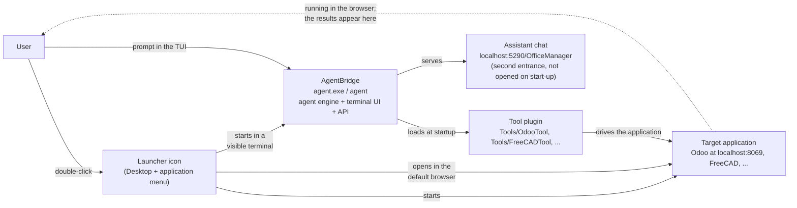

# Tool installers and launchers — the AgentBridge contract

> **Audience:** maintainers of AgentBridge and of every tool that ships an installer
> (OdooTool, FreeCADTool, and future tools). This is a **developer document**: it lives in
> `docs-dev/` and is not shipped with the app.
>
> **The rule in one sentence:** an installer must leave the user in the single-agent
> configuration **AgentBridge + tool plugin + target application**, with a launcher icon that
> starts the application, starts AgentBridge in a **visible terminal**, and opens the
> **application** in the browser — never the application alone, and never a background assistant
> nobody can see.

## The three-part stack

Every tool in this ecosystem is a **plugin**, not a standalone application. It needs a host
that runs the agent, and it needs the application it pilots. The installer is what puts the
three parts together and leaves them ready to use.



The user's first interaction is a **prompt in the assistant's terminal**: *"list the customers"*,
*"create a quotation for Acme"*, *"make this bracket 2 mm thicker"*. AgentBridge passes it to
the agent, the agent calls the tool plugin, and the plugin changes the application. The
application is already running and already open in the browser, so the user watches the result
where it lands.

## AgentBridge and OfficeManager

`OfficeManager` is the **browser chat served by AgentBridge** at `/OfficeManager` (port 5290 in
the tool installers). It is a **second entrance**, not the first screen: the launcher starts the
terminal UI, which is where the user types the prompt and watches the agent work, and opens the
**target application** in the browser so the result is visible where it lands. The name is
historical — the same page also carries the optional multi-agent view — but in a standard tool
installation it drives **one** agent.

| | **AgentBridge** | **OfficeManager** |
|---|---|---|
| What it is | The base program: agent engine, terminal UI, OpenAI-compatible API | The browser chat and office view served **by AgentBridge** at `/OfficeManager` |
| Role in a tool install | Hosts the agent, loads the tool plugin, and is the launcher's visible window | An alternative window for users who prefer a browser; reachable on purpose |
| Agents | One conversation/agent at a time — the normal local use | Can show many agent/subagent instances, but the installer does not configure them |
| Hardware | One model in VRAM, one agent working | Many agents would share the same GPU/VRAM |

OfficeManager is not a separate product that competes with AgentBridge: it is a surface inside
AgentBridge. The launcher does not open it, because a user who double-clicks an icon for an ERP
expects to see that ERP; opening the assistant's chat instead hid the application behind a page
nobody had asked for (reversed 2026-11-14, see OdooTool's `INSTALLER-CONTRACT.md`). The old
behaviour also produced the opposite complaint, recorded as
[OdooTool issue #7](https://github.com/Graphene-Lab/OdooTool/issues/7): an Odoo-only shortcut
showed the ERP login and the assistant was nowhere to be found. Both mistakes have the same
root — opening *one* of the two halves instead of starting both and showing the one the user
asked for.

## Why the default is a single agent

AgentBridge is **privacy-first**: the intended deployment is a local LLM on the user's own
machine. That changes the economics of parallelism compared with a datacenter.

- **Local hardware is fixed.** One machine has one GPU and one VRAM budget. Adding a second
  agent does not add a second GPU; both agents share the same model and the same memory.
- **More agents do not finish sooner.** Agents are instantiated in parallel to save time only
  when the hardware scales with them. On a local machine, two agents contend for the same
  compute: they slow each other down, the total time does not improve, and the user waits
  longer for each answer.
- **The stack can collapse.** A second model instance or a second concurrent conversation can
  exhaust VRAM or RAM. The result is not "twice the work" but an out-of-memory error, a
  swapped-to-disk machine, or a crashed agent — exactly when the user is in the middle of a
  task.
- **In a datacenter the hardware grows with the agents.** That is the scenario where
  multi-agent orchestration pays off: more agents come with more compute. A home or small
  office PC is not that scenario.

Therefore the standard configuration for the end user is **one agent**:

```
AgentBridge  <->  tool plugin  <->  target application
```

This is why the installer's launcher starts the application, starts AgentBridge in a visible
terminal, and opens the application in the browser — one agent, not a multi-agent workload, and
not the application alone. The office view at `/OfficeManager` is the one place where several
agents can be started, and it is therefore **never opened automatically**: with a local model it
is a trap, because parallel agents share one GPU and one VRAM budget, slow each other down
instead of finishing sooner, and can exhaust the memory and take the stack down. It stays
available for the user who deliberately wants it, and for providers whose hardware scales with
the number of agents.

## The installer contract

An installer for a tool that pilots an application **must**:

1. **Install AgentBridge** (the public release archive for the platform).
2. **Install the tool plugin** into `Tools/<Tool>/` next to the AgentBridge executable and
   make it **active by default** (write its configuration, credentials and API key).
3. **Install the target application** and make it reachable on its local address.
4. **Create launcher icons** in the system application menu/launcher **and** on the desktop.
5. **Start the stack from the launcher**:
   - start the target application (if it is not already running) and wait until it answers;
   - start **AgentBridge** with the plugin active (if the assistant chat is not already
     answering — do not start a second instance);
   - wait until the assistant chat answers;
   - open the **assistant chat** in the **system default browser**
     (`http://localhost:5290/OfficeManager` for the current tools).
6. **Leave the user able to type a prompt immediately**, with the application already running
   behind the chat. Print the application URL and login so the user can open its UI when they
   want to watch the result.
7. **Be safe to re-run**: keep existing configuration, credentials and API keys instead of
   replacing them.
8. **Make the first run simple**: automate database creation, admin credentials, API keys and
   any other one-time setup. At the end of a successful run, **open the vendor's first-start
   documentation for the exact version being installed in the default browser** and print the
   URL as well, so the guidance is visible even when no browser can be opened.
9. **Explain the flow in the final message**: the one-click icon, what it starts, the login
   credentials, and the manual commands for troubleshooting.

The contract is about the **default** behaviour. A user who explicitly wants a different
shortcut can be given an additional, clearly separate one; the standard icon stays as
specified.

If the tool embeds the assistant in the application itself (FreeCADTool's Chat workbench),
opening the application with the document is the equivalent of opening the chat: the rule is
that the user lands in the assistant, not that a browser tab is mandatory.

## Anti-patterns — do not do these

- **A shortcut that opens only the application.** The user would get Odoo/FreeCAD with no
  assistant and would have to discover AgentBridge on their own. This is the most common
  regression request ("just open Odoo"), and it breaks the product's one-click promise.
- **A shortcut that opens the application's login page instead of the assistant chat.** This
  is the regression behind OdooTool issue #7: the user sees the ERP login and concludes the
  assistant is missing. The chat is the first screen; the application is the data behind it.
- **Waiting for the assistant chat before starting AgentBridge.** The wait loop must come
  *after* the assistant is launched (and only when it is not already answering), otherwise a
  cold start waits for a process that was never started and then reports a failure.
- **Asking the user to start AgentBridge manually** after the installer finishes. The
  installer's job is to leave a working stack, not a list of instructions.
- **Installing the plugin but leaving it inactive.** The plugin must be in `Tools/<Tool>/`
  with its configuration written before the launcher is created.
- **Configuring a multi-agent workload by default.** One agent is the standard local
  configuration (see above). The multi-agent view remains available, but the installer does
  not enable or encourage it.
- **Making the user go through the application's first-run wizard** (for example the Odoo
  database manager) when the installer can create the database and credentials itself.
- **Changing or removing the default launcher to satisfy a single user request** without
  reviewing this contract. Add an optional shortcut instead, and keep the standard icon.

## First run

The installer must not leave the user at a setup screen it could have completed itself.

For **Odoo 20 Community**, the OdooTool installer already:

- creates the `odoo_agent` database with the `base` modules (`-i base --without-demo`);
- sets the admin login and password (generated locally, printed in the final summary);
- creates the API key and writes it to `agentbridge/PersistentData/odoo.json`;
- starts Odoo and waits until `/web/login` answers.

The user must therefore **not** see the Odoo database manager. If they do, the installation did
not complete: run the installer again (it resumes) and check the final summary. The vendor
documentation for the installed version is:

- Odoo 20 User Docs — <https://www.odoo.com/documentation/20.0/applications.html>
- Odoo 20 installation — <https://www.odoo.com/documentation/20.0/administration/install.html>

The installer prints these links in its final message **and opens the user-docs page in the
default browser** at the end of a successful run. This is deliberate: users who reached a
working AgentBridge + Odoo stack still did not know what to do next, so the vendor's first
steps are put in front of them instead of only being printed in a console they may close.
The URL is printed as well, for headless runs where no browser can be opened.

## Reference implementations

| Installer | What it does |
|---|---|
| **OdooTool — Windows** (`OdooTool/installer/install.ps1`) | Creates `start.ps1` and the **AI Odoo** shortcut on the Desktop and in the Start Menu. The launcher starts Odoo, starts `agentbridge\agent.exe` if the chat is not answering, waits for `http://localhost:5290/OfficeManager`, then opens it in the default browser. At the end of the install it opens the Odoo 20 first-steps page. |
| **OdooTool — Linux/WSL** (`OdooTool/installer/install.sh`) | Creates `start.sh` and `ai-odoo.desktop` in `~/.local/share/applications` and `~/Desktop`. The launcher starts Odoo, starts `agentbridge/agent` detached if the chat is not answering, waits for `http://localhost:5290/OfficeManager`, then opens it with `xdg-open`. At the end of the install it opens the Odoo 20 first-steps page. |
| **FreeCADTool** (`FreeCADTool/installer/`) | Creates the **AI FreeCAD** launcher; it starts AgentBridge and opens FreeCAD with the document, so the user can go from the desktop to a prompt that edits the open model. |

## Checklist for a new installer

- [ ] AgentBridge is installed and starts on the target platform.
- [ ] The tool plugin is in `Tools/<Tool>/` and active by default.
- [ ] The target application is installed and reachable on its local address.
- [ ] A launcher icon exists in the application menu/launcher **and** on the desktop.
- [ ] The launcher starts the application and AgentBridge, then opens the **assistant chat**
      in the default browser (not the application's login page).
- [ ] The final message prints the application URL and login, so its UI can be opened to watch
      the result.
- [ ] The user can type a prompt immediately and the agent can act on the application.
- [ ] Re-running the installer preserves configuration and credentials.
- [ ] First run is automated, and the vendor's version-specific first-start page is opened in
      the default browser (the URL is printed too).
- [ ] The final message explains the one-click flow, the credentials and the manual commands.

## Where this contract is enforced

- **This document** — the architecture decision and its rationale.
- **`AgentBridge/AGENTS.md`** — the reminder every coding agent sees before touching an installer.
- **`OdooTool/INSTALLER-CONTRACT.md`** — the tool-side copy, with the OdooTool-specific details.
- **Header comments in `OdooTool/installer/install.ps1`, `install.sh` and `install.bat`** — the
  rule sits next to the code that creates the launcher.

If a future tool ships an installer, copy the relevant parts of this contract into that
repository and add the same header comment to its installer sources.

## Decision record

- **Date:** 2026-11-09
- **Decision:** the default launcher for a tool installation starts the target application and
  AgentBridge (single agent) with the tool plugin already active, and opens the assistant chat
  (`/OfficeManager`, served by AgentBridge) in the default browser. The application URL and
  login are printed; its UI is opened by the user when they want to watch the result.
- **Rationale:** privacy-first local LLM deployment; fixed GPU/VRAM makes parallel agents
  contend instead of scale, with no time benefit and a risk of exhausting memory.
- **Consequences:** every tool installer creates the launcher in the application menu and on
  the desktop, automates the first run where possible, opens the vendor's first-steps page at
  the end of a successful installation, and keeps the standard icon stable even when a user
  asks for an application-only shortcut.
