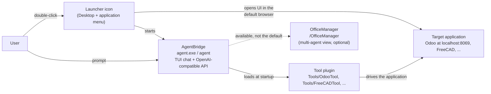

# Tool installers and launchers — the AgentBridge contract

> **Audience:** maintainers of AgentBridge and of every tool that ships an installer
> (OdooTool, FreeCADTool, and future tools). This is a **developer document**: it lives in
> `docs-dev/` and is not shipped with the app.
>
> **The rule in one sentence:** an installer must leave the user in the single-agent
> configuration **AgentBridge + tool plugin + target application**, with a launcher icon that
> starts both — never the target application alone, and never OfficeManager by default.

## The three-part stack

Every tool in this ecosystem is a **plugin**, not a standalone application. It needs a host
that runs the agent, and it needs the application it pilots. The installer is what puts the
three parts together and leaves them ready to use.



The user's first interaction is a **prompt**: *"list the customers"*, *"create a quotation for
Acme"*, *"make this bracket 2 mm thicker"*. AgentBridge passes it to the agent, the agent calls
the tool plugin, and the plugin changes the application. The application UI is open in the
browser so the user can watch the result.

## AgentBridge vs OfficeManager

These are not two names for the same thing, and they are not interchangeable as the default
entry point.

| | **AgentBridge** | **OfficeManager** |
|---|---|---|
| What it is | The base program: hosts the agent engine, the terminal/chat UI and the OpenAI-compatible API | A web view of the agents' office, served **by AgentBridge** at `/OfficeManager` |
| Scope | **One** conversation/agent at a time — the normal local use | Visualises and drives **many** agent and subagent instances at once |
| Default for installers | **Yes** — this is what the launcher must start | **No** — optional, for users who deliberately want the multi-agent view |
| Hardware | One model in VRAM, one agent working | Many agents sharing the same GPU/VRAM |

OfficeManager is not a separate product that competes with AgentBridge: it is a surface
inside AgentBridge for watching and steering a fleet of agents. It is genuinely useful when
many agents run in parallel, and it remains available at `/OfficeManager` for anyone who wants
it. It is simply **not the standard first screen** for a tool installation.

## Why the default is a single agent

AgentBridge is **privacy-first**: the intended deployment is a local LLM on the user's own
machine. That changes the economics of parallelism compared with a datacenter.

- **Local hardware is fixed.** One machine has one GPU and one VRAM budget. Adding a second
  agent does not add a second GPU; both agents share the same model and the same memory.
- **More agents do not finish sooner.** Agents are instantiated in parallel to save time only
  when the hardware scales with them. On a local machine, two agents contend for the same
  compute: they slow each other down, the total time does not improve, and the user waits
  longer for each answer.
- **The stack can collapse.** A second model instance or a second concurrent conversation can
  exhaust VRAM or RAM. The result is not "twice the work" but an out-of-memory error, a
  swapped-to-disk machine, or a crashed agent — exactly when the user is in the middle of a
  task.
- **In a datacenter the hardware grows with the agents.** That is the scenario where
  multi-agent orchestration pays off: more agents come with more compute. A home or small
  office PC is not that scenario.

Therefore the standard configuration for the end user is **one agent**:

```
AgentBridge  <->  tool plugin  <->  target application
```

This is why the installer's launcher starts AgentBridge (with the plugin already loaded) and
the application UI — not OfficeManager, and not the application alone.

## The installer contract

An installer for a tool that pilots an application **must**:

1. **Install AgentBridge** (the public release archive for the platform).
2. **Install the tool plugin** into `Tools/<Tool>/` next to the AgentBridge executable and
   make it **active by default** (write its configuration, credentials and API key).
3. **Install the target application** and make it reachable on its local address.
4. **Create launcher icons** in the system application menu/launcher **and** on the desktop.
5. **Start both parts from the launcher**:
   - start the target application (if it is not already running) and wait until it answers;
   - open the application UI in the **system default browser** on its home page;
   - start **AgentBridge** with the plugin active.
6. **Leave the user able to type a prompt immediately**, with the application already open
   beside the assistant.
7. **Be safe to re-run**: keep existing configuration, credentials and API keys instead of
   replacing them.
8. **Make the first run simple**: automate database creation, admin credentials, API keys and
   any other one-time setup. If a step genuinely cannot be automated, print — or open in the
   default browser — the vendor's first-start documentation **for the exact version being
   installed**.
9. **Explain the flow in the final message**: the one-click icon, what it starts, the login
   credentials, and the manual commands for troubleshooting.

The contract is about the **default** behaviour. A user who explicitly wants a different
shortcut can be given an additional, clearly separate one; the standard icon stays as
specified.

## Anti-patterns — do not do these

- **A shortcut that opens only the application.** The user would get Odoo/FreeCAD with no
  assistant and would have to discover AgentBridge on their own. This is the most common
  regression request ("just open Odoo"), and it breaks the product's one-click promise.
- **A shortcut that opens OfficeManager by default.** OfficeManager is the multi-agent view.
  It is not the single-agent cockpit the installer is supposed to deliver, and on a local
  machine it invites exactly the parallel-agent load described above.
- **Asking the user to start AgentBridge manually** after the installer finishes. The
  installer's job is to leave a working stack, not a list of instructions.
- **Installing the plugin but leaving it inactive.** The plugin must be in `Tools/<Tool>/`
  with its configuration written before the launcher is created.
- **Making the user go through the application's first-run wizard** (for example the Odoo
  database manager) when the installer can create the database and credentials itself.
- **Changing or removing the default launcher to satisfy a single user request** without
  reviewing this contract. Add an optional shortcut instead, and keep the standard icon.

## First run

The installer must not leave the user at a setup screen it could have completed itself.

For **Odoo 20 Community**, the OdooTool installer already:

- creates the `odoo_agent` database with the `base` modules (`-i base --without-demo`);
- sets the admin login and password (generated locally, printed in the final summary);
- creates the API key and writes it to `agentbridge/PersistentData/odoo.json`;
- starts Odoo and waits until `/web/login` answers.

The user must therefore **not** see the Odoo database manager. If they do, the installation did
not complete: run the installer again (it resumes) and check the final summary. The vendor
documentation for the installed version is:

- Odoo 20 User Docs — <https://www.odoo.com/documentation/20.0/applications.html>
- Odoo 20 installation — <https://www.odoo.com/documentation/20.0/administration/install.html>

The installer prints these links in its final message. It does not open a second browser tab,
because the launcher already opens the application itself; the links are the fallback for a
first-run step that could not be automated.

## Reference implementations

| Installer | What it does |
|---|---|
| **OdooTool — Windows** (`OdooTool/installer/install.ps1`) | Creates `start.ps1` and the **AI Odoo** shortcut on the Desktop and in the Start Menu. The launcher starts Odoo, opens `http://localhost:8069`, then starts `agentbridge\agent.exe`. |
| **OdooTool — Linux/WSL** (`OdooTool/installer/install.sh`) | Creates `start.sh` and `ai-odoo.desktop` in `~/.local/share/applications` and `~/Desktop`. The launcher starts Odoo, runs `xdg-open` on the Odoo URL, then launches `agentbridge/agent`. |
| **FreeCADTool** (`FreeCADTool/installer/`) | Creates the **AI FreeCAD** launcher; it starts AgentBridge and opens FreeCAD with the document, so the user can go from the desktop to a prompt that edits the open model. |

## Checklist for a new installer

- [ ] AgentBridge is installed and starts on the target platform.
- [ ] The tool plugin is in `Tools/<Tool>/` and active by default.
- [ ] The target application is installed and reachable on its local address.
- [ ] A launcher icon exists in the application menu/launcher **and** on the desktop.
- [ ] The launcher starts AgentBridge **and** opens the application UI in the default browser.
- [ ] The user can type a prompt immediately and the agent can act on the application.
- [ ] Re-running the installer preserves configuration and credentials.
- [ ] First run is automated, or the vendor's version-specific first-start page is printed/opened.
- [ ] The final message explains the one-click flow, the credentials and the manual commands.

## Where this contract is enforced

- **This document** — the architecture decision and its rationale.
- **`AgentBridge/AGENTS.md`** — the reminder every coding agent sees before touching an installer.
- **`OdooTool/INSTALLER-CONTRACT.md`** — the tool-side copy, with the OdooTool-specific details.
- **Header comments in `OdooTool/installer/install.ps1`, `install.sh` and `install.bat`** — the
  rule sits next to the code that creates the launcher.

If a future tool ships an installer, copy the relevant parts of this contract into that
repository and add the same header comment to its installer sources.

## Decision record

- **Date:** 2026-11-09
- **Decision:** the default launcher for a tool installation starts AgentBridge (single agent)
  with the tool plugin already active, and opens the target application UI. OfficeManager is
  not the default entry point.
- **Rationale:** privacy-first local LLM deployment; fixed GPU/VRAM makes parallel agents
  contend instead of scale, with no time benefit and a risk of exhausting memory.
- **Consequences:** every tool installer creates the launcher in the application menu and on
  the desktop, automates the first run where possible, and keeps the standard icon stable even
  when a user asks for an application-only shortcut.
